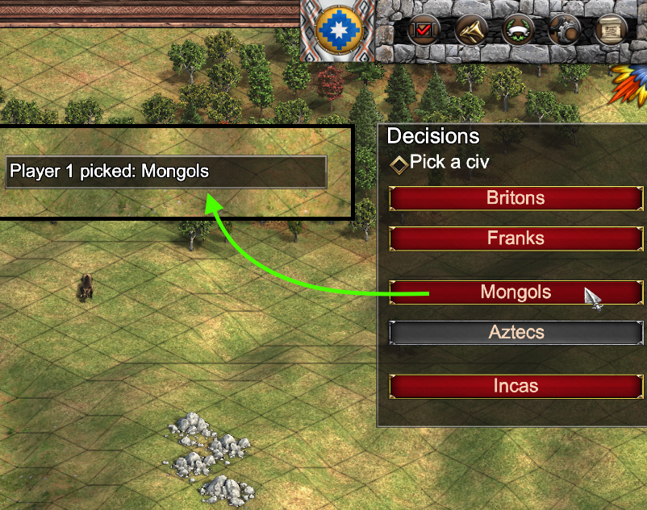

# XsDecisions

A simple-to-use wrapper around the AoE2 XS Decisions API which adds support for more than two choices per question and 
callbacks when choices are made! 

> [!WARNING]
> The XS Decisions API is currently only available in the **Public Update Preview (PUP)**.  
> Tested on build `101.103.58865.0` (Update `189937`). It won't work on the live version of the game _yet_.

This library has some major advantages over the native decisions API:

1. Allows more than two choices per question
2. Simple choice and question callback functionality 
3. Easily re-use questions (in decision trees)
4. Remembers answers after decision IDs are recycled
5. Automatic decision ID management (No manual fiddling counters)

**Contents:** 
[Example](#example-usage) · 
[Setup](#1-setting-up-the-script) · 
[Questions](#2-create-the-questions) · 
[Choices](#3-add-the-choices-to-the-question) · 
[Answers](#4-working-with-answers) · 
[Callbacks](#5-callback-functionality) · 
[Behind the scenes](#6-behind-the-scenes) · 
[Functions API](#functions-api) · 
[License](#license)

## Example usage

The following example shows a simple question asking both player one and player two which civ they'd like to pick. 
Once a choice has been made, the registered callback `onAnswer(...)` is called causing a chat showing the result to be 
sent. 

```cpp
include "decisions.xs";

void onAnswer(int answerArray = -1) {
    string choice = decisionGetChoice(answerArray);
    int player = decisionGetPlayer(answerArray);
    
    xsChatData(fstr("Player {player} picked: {choice}"));
}

void main() {
    /* Create a question with 5 choices */
    int q = decisionCreateWithChoices("Pick a civ", "Britons|Franks|Mongols|Aztecs|Incas", "onAnswer");
    
    /* Ask player one and player two */
    decisionAsk(q, 1);
    decisionAsk(q, 2);
}
```



---

# Using XsDecisions

## 1. Setting up the script

There are two ways of setting up XsDecisions. You can use either option. 
The main advantage of the "include" method is being able to replace the file more easily if there are any updates in 
the future.

### Option A - Using `include`

1. Place the `decisions.xs` file in your XS scripts folder:  
   `C:\Users\<user>\Games\Age of Empires 2 DE\<steamId>\resources\_common\xs\`  
   (Or any other folder in which AoE2 DE will look for scripts)

2. Then add this to the top of your script:
   ```cpp
   include "decisions.xs";
   ```

### Option B - Copy and paste the entire code

Copy and paste the entire content of `decisions.xs` at the top of your XS script.

## 2. Create the questions

Defining a question is simple. You can call the `decisionCreate(...)` function.

```cpp
void main() {
    int q1 = decisionCreate("What is your favourite unit?");
}
```

## 3. Add the choices to the question

There are two ways to add choices to your question:

### 3.1 Using `decisionAddChoice(...)`

The most expressive way to add choices to your question is by calling `decisionAddChoice(...)`.

```cpp
void main() {
    int q1 = decisionCreate("What is your favourite unit?");
    decisionAddChoice(q1, "Two Handed Swordsman");
    decisionAddChoice(q1, "Magundai");
    decisionAddChoice(q1, "Siege Onager");
    decisionAddChoice(q1, "Monk");
}
```

### 3.2 Using `decisionCreateWithChoices(...)`

This method creates both the question and the choices in one go. 
It is quicker to write, but can become a bit unreadable with many choices. 

```cpp
void main() {
    int q1 = decisionCreateWithChoices("What is your favourite unit?", "Two Handed Swordsman|Magundai|Siege Onager|Monk");
}

// Or:
    
void main() {
    string choices = "Two Handed Swordsman|Magundai|Siege Onager|Monk";
    int q1 = decisionCreateWithChoices("What is your favourite unit?", choices);
}
```

As you can see, you can separate every choice by a pipe `|`.  

Technically you could even combine `decisionCreateWithChoices(...)` and `decisionAddChoice(...)` though it is not 
recommended due to readability. 

> **Note: odd number of choices**  
> Choices are shown two per decision, so with an odd number of choices the last decision only has one choice. 
> Normally the empty second button is hidden. But when another decision is shown below it, an empty button appears 
> that can be clicked. It then counts as the last choice. 
> If you want to avoid this, use an even number of choices. See [6. Behind the scenes](#6-behind-the-scenes).

## 4. Working with answers

There are again a couple of ways to work with the answers the players give. All of them are described below.

It is also possible to combine any of the callback options below. 
You can safely add a choice callback, question callback and use "answer polling" together on a single question.
Callbacks are called in this order: question callback, then choice callback.  

### 4.1 Choice Callbacks

For every choice you add you can add a "callback".
A callback is a function that is called automatically upon a player clicking the corresponding choice.

Below you can see multiple ways to set a choice callback and how to use them:

#### 4.1.1 Choice callback on `decisionAddChoice(...)`

With the example below you can see how a question has two choices, each with its own callback.
When `Yes` is clicked, a chat message will be sent: `The answer is: YES`.

```cpp
void onYes(int answerArray = -1) {
    xsChatData("The answer is: YES");  
}

void onNo(int answerArray = -1) {
    xsChatData("The answer is: NO");  
}

void main() {
    int q1 = decisionCreate("Do you want to trade gold?");
    decisionAddChoice(q1, "Yes", "onYes");
    decisionAddChoice(q1, "No", "onNo");
}
```

#### 4.1.2 Choice callback on `decisionCreateWithChoices(...)`

This is a shorthand for the above. You can use `:::` to add a callback to a choice.
You can probably tell why this style is not recommended for larger questions. 
Everything ends up in one long string, which quickly becomes hard to read.

```cpp
/* Also needs `onYes(...)` and `onNo(...)` from the above code block */

void main() {
    int q1 = decisionCreateWithChoices("Do you want to trade gold?", "Yes:::onYes|No:::onNo");
}
```

### 4.2 Question Callbacks

Like choices, callbacks can also be added to questions.
This means this callback is called no matter which choice is clicked by the player. 
Both `decisionCreate(...)` and `decisionCreateWithChoices(...)` allow adding a callback as their second and third 
argument respectively.

With this example, the `onAnswer` function will be called as soon as **either** option is clicked.

```cpp
void onAnswer(int answerArray = -1) { ... }

void main() {
    int q1 = decisionCreate("Accept treaty?", "onAnswer");
    decisionAddChoice(q1, "Yes");
    decisionAddChoice(q1, "No");

    // Or, the same in one call:
    int q2 = decisionCreateWithChoices("Accept treaty?", "Yes|No", "onAnswer");
}
```

### 4.3 Answer Polling

Instead of callbacks, you can check for an answer yourself using the value returned by `decisionAsk(...)`.
This can be useful for waiting on multiple answers/players or adding a default choice with a time limit.

```cpp
int a1 = -1;

void main() {
    int q1 = decisionCreateWithChoices("Accept treaty?", "Yes|No");
    int player = 1;
    
    a1 = decisionAsk(q1, player);
}

rule hasAnswered active minInterval 1 {
    if (decisionWasMade(a1) == false) {
        return;
    }

    xsChatData("Player " + decisionGetPlayer(a1) + " picked: " + decisionGetChoice(a1));
    xsDisableSelf();
}
```

## 5. Callback functionality

### 5.1 Writing a callback

A callback is passed by its name as a string, e.g. `"onAnswer"`. 
The function **must** look like this, with exactly one `int` argument:

```cpp
void onAnswer(int answerArray = -1) { ... }
```

### 5.2 Reading the answer

The `answerArray` argument holds all information about the answer. 
Use the functions below to read from it. These also work on the value returned by `decisionAsk(...)` (See [4.3](#43-answer-polling)).

| Function                      | Type     | Returns                                           |
|-------------------------------|----------|---------------------------------------------------|
| `decisionGetChoice(...)`      | `string` | The text of the chosen choice, e.g. `"Yes"`       |
| `decisionGetChoiceIndex(...)` | `int`    | The index of the chosen choice, starting at `0`   |
| `decisionGetPlayer(...)`      | `int`    | The player the question was asked to              |
| `decisionGetQuestion(...)`    | `int`    | The question ID returned by `decisionCreate(...)` |
| `decisionWasMade(...)`        | `bool`   | `true` if the question has been answered          |

The example below gives 1000 gold to whoever picks `Gold`:

```cpp
void onAnswer(int answerArray = -1) {
    int player = decisionGetPlayer(answerArray);
    
    if (decisionGetChoice(answerArray) == "Gold") {
        xsSetPlayerAttribute(player, cAttributeGold, xsPlayerAttribute(player, cAttributeGold) + 1000);
    }
}

void main() {
    int q1 = decisionCreateWithChoices("Pick a reward", "Gold|Nothing", "onAnswer");
    decisionAsk(q1, 1);
}
```

### 5.3 Asking questions from a callback (Decision trees)

You can call `decisionAsk(...)` inside a callback to ask a follow-up question. 
This is how you build decision trees. Questions can be asked again as often as you like.

```cpp
int qStart = -1;
int qSure = -1;

void onRefuse(int answerArray = -1) {
    decisionAsk(qSure, decisionGetPlayer(answerArray));
}

void onReconsider(int answerArray = -1) {
    decisionAsk(qStart, decisionGetPlayer(answerArray));
}

void main() {
    qStart = decisionCreate("The Khan demands tribute. Will you pay?");
    decisionAddChoice(qStart, "Pay 1000 gold");
    decisionAddChoice(qStart, "Refuse", "onRefuse");

    qSure = decisionCreate("Are you sure? The Khan will attack!");
    decisionAddChoice(qSure, "Yes");
    decisionAddChoice(qSure, "No, let me reconsider", "onReconsider");

    decisionAsk(qStart, 1);
}
```

For a complete version of this example, see [`examples/tribute-khan.xs`](examples/tribute-khan.xs).

## 6. Behind the scenes

_You don't need this to use XsDecisions. It's here for those curious how it works._

The AoE2 XS Decisions API only supports **two** choices per decision. 
XsDecisions works around this by splitting a question into multiple decisions:

1. **Asking:** `decisionAsk(...)` splits the choices into pairs and creates one decision per pair. 
   The question text is only shown on the first one. A 5-choice question therefore shows 3 decisions.
2. **Tracking:** Every ask gets its own "answer array", which is returned by `decisionAsk(...)`. 
   All decisions of that ask are linked to it, so the same question can be asked to multiple players at once.
3. **Answering:** A rule checks all active decisions every second. Once one is clicked, all other decisions of that ask
   are removed. The clicked button is converted back to the original choice, and stored in the answer array.
4. **Callbacks:** The question callback is called, followed by the choice callback, both with the answer array.
5. **Cleaning up:** After clicking, the game keeps showing the decision for about 3 seconds. 
   The decision IDs are only re-used after that, so new decisions don't conflict with old ones.

---

# Functions API

## `decisionCreate(question, callback)`

Creates a question without any choices. Add choices using: `decisionAddChoice(...)`

| Type     | Argument   | Description                                                    | Required   |
|----------|------------|----------------------------------------------------------------|------------|
| `string` | `question` | The text of the question to be asked                           | _Required_ |
| `string` | `callback` | The callback to call when any choice for this question is made | _Optional_ |

Returns: `int` The `questionId` referencing this question

---

## `decisionCreateWithChoices(question, pipeSeparatedChoices, callback)`

Creates a question with the choices in a single call.  
Callbacks per choice can be added by adding `:::<func>` after a choice.   
Like: `Yes:::onYes|No:::onNo`, where you'd need functions like: `void onYes(int answerArray = -1) { ... }`

| Type     | Argument               | Description                                                    | Required   |
|----------|------------------------|----------------------------------------------------------------|------------|
| `string` | `question`             | The text of the question to be asked                           | _Required_ |
| `string` | `pipeSeparatedChoices` | The question choices separated by `\|`                         | _Required_ |
| `string` | `callback`             | The callback to call when any choice for this question is made | _Optional_ |

Returns: `int` The `questionId` referencing this question

---

## `decisionAddChoice(questionId, choice, callback)`

Adds a choice to a question based on the given `questionId`.

| Type     | Argument     | Description                                                         | Required   |
|----------|--------------|---------------------------------------------------------------------|------------|
| `int`    | `questionId` | The question ID to add a choice to (Returned from `decisionCreate`) | _Required_ |
| `string` | `choice`     | The text of the choice to be shown (Cannot be `""`)                 | _Required_ |
| `string` | `callback`   | The callback to call when this choice is clicked                    | _Optional_ |

Returns: `int` The `choiceIndex` referencing this choice

---

## `decisionAsk(questionId, player)`

Ask a question to a specific player.

| Type  | Argument     | Description                                                      | Required   |
|-------|--------------|------------------------------------------------------------------|------------|
| `int` | `questionId` | The question ID to ask a player (Returned from `decisionCreate`) | _Required_ |
| `int` | `player`     | The player to ask the question to.                               | _Required_ |

Returns: `int` Reference to the `answerArray` which will be populated once a choice has been made

---

## `decisionWasMade(answerArray)`

Checks if a decision has been made yet. This is _not_ useful inside callbacks.

| Type  | Argument      | Description                                                                                                  | Required   |
|-------|---------------|--------------------------------------------------------------------------------------------------------------|------------|
| `int` | `answerArray` | The array that was returned from a `decisionAsk` call, or from the only parameter inside a callback function | _Required_ |

Returns: `bool` If a choice was clicked for a specific ask

---

## `decisionGetPlayer(answerArray)`

| Type  | Argument      | Description                                                                                                  | Required   |
|-------|---------------|--------------------------------------------------------------------------------------------------------------|------------|
| `int` | `answerArray` | The array that was returned from a `decisionAsk` call, or from the only parameter inside a callback function | _Required_ |

Returns: `int` The player to whom this question was asked. Note, asking to `-1` (Officially not supported) will result in this returning `-1` too.

---

## `decisionGetChoice(answerArray)`

| Type  | Argument      | Description                                                                                                  | Required   |
|-------|---------------|--------------------------------------------------------------------------------------------------------------|------------|
| `int` | `answerArray` | The array that was returned from a `decisionAsk` call, or from the only parameter inside a callback function | _Required_ |

Returns: `string` The choice that was clicked as text

---

## `decisionGetQuestion(answerArray)`

| Type  | Argument      | Description                                                                                                  | Required   |
|-------|---------------|--------------------------------------------------------------------------------------------------------------|------------|
| `int` | `answerArray` | The array that was returned from a `decisionAsk` call, or from the only parameter inside a callback function | _Required_ |

Returns: `int` The ID of the question returned from `decisionCreate` functions for this ask

---

## `decisionGetChoiceIndex(answerArray)`

| Type  | Argument      | Description                                                                                                  | Required   |
|-------|---------------|--------------------------------------------------------------------------------------------------------------|------------|
| `int` | `answerArray` | The array that was returned from a `decisionAsk` call, or from the only parameter inside a callback function | _Required_ |

Returns: `int` The choice that was clicked as index for the choice on that question. Starting from 0.

---

# License

XsDecisions is licensed under the [GNU General Public License v3.0](LICENSE).
